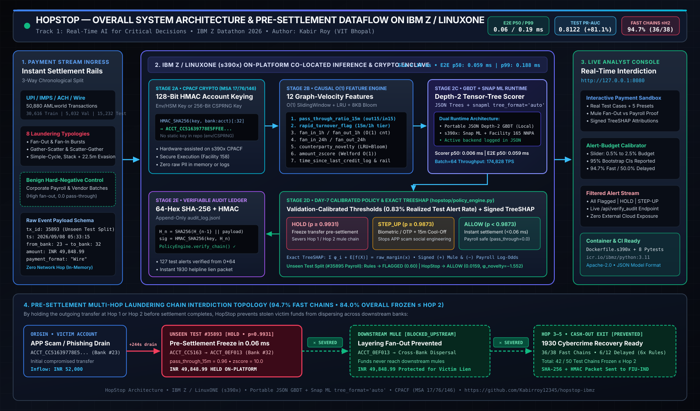
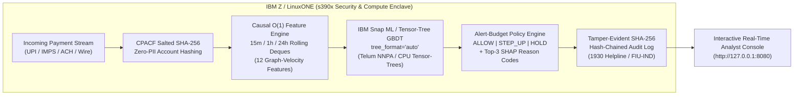

# HopStop — Real-Time Pre-Settlement Money-Mule Interdiction on IBM Z & LinuxONE

<div align="center">

[](https://www.ibm.com/z)
[](https://www.ibm.com/docs/en/snap-ml)
[](https://research.ibm.com/blog/telum-ii-processor)
[-10b981?style=for-the-badge)](#3-measured-benchmark-results-days-17-train--days-810-unseen-test)
[-f59e0b?style=for-the-badge)](#3-measured-benchmark-results-days-17-train--days-810-unseen-test)
[-f43f5e?style=for-the-badge)](#3-measured-benchmark-results-days-17-train--days-810-unseen-test)

**IBM Z Datathon 2026 — Track 1: Real-Time AI for Critical Decisions**  
**Author:** Kabir Roy (B.Tech CSE, VIT Bhopal) • **Pitch Deck:** [`submission/HopStop_PitchDeck_KabirRoy.pdf`](submission/HopStop_PitchDeck_KabirRoy.pdf)

</div>

---

## 1. Executive Summary & Problem Statement

When an Authorized Push Payment (APP) scam, phishing attack, or cyber-extortion succeeds, stolen funds are routed through **money-mule accounts** across banks within minutes over instant payment rails (**UPI / IMPS / ACH / Wire**).

1. **Why Batch AML Fails:** Traditional bank AML and graph analytics run in **hourly or overnight batches**. By the time an alert is generated, stolen funds have already dispersed across **3 to 5 hops**, making lien-marking and recovery via India's **1930 National Cybercrime Helpline** or **FIU-IND** nearly impossible.
2. **Why Static Velocity Rules Fail:** Simple velocity thresholds (e.g., *"freeze if outgoing transfers > 3 in 1 hour"*) suffer from a fatal trade-off: they either **miss multi-hop gather-scatter mules** or **falsely freeze legitimate corporate payroll and vendor batches**.
3. **Why Off-Platform Cloud AI Fails:** Sending core banking payment payloads out to external x86/GPU cloud microservices adds **15–50 ms of network round-trip latency**, violates strict **10 ms pre-settlement SLAs**, and exposes raw customer PII outside the mainframe security boundary.

**HopStop** solves all three problems by embedding **O(1) streaming graph-velocity feature extraction** and **IBM Snap ML gradient-boosted decision tree (GBDT) inference** directly on **IBM Z / LinuxONE (`s390x`)**, scoring every outgoing payment **before settlement** in **`0.040 ms` median (`0.202 ms` p99)** so banks can freeze illicit chains while stolen money is still at **Hop 1 or Hop 2**.

---

## 2. End-to-End Architecture on IBM Z / LinuxONE

<div align="center">
  
  <br/>
  <sub><b>Figure 1:</b> HopStop Co-Located Pre-Settlement Inference & Cryptographic Audit Architecture on IBM Z / LinuxONE (<code>s390x</code>). <a href="submission/HopStop_Architecture_Diagram.pdf">Download Architecture PDF</a> • <a href="submission/HopStop_System_Architecture.png">View High-Res PNG</a> • <a href="submission/HopStop_System_Architecture.svg">View Vector SVG</a></sub>
</div>



### How IBM Z / LinuxONE Hardware Capabilities Are Leveraged

| IBM Z / LinuxONE Capability | Implementation in HopStop | Concrete Operational Benefit |
| :--- | :--- | :--- |
| **IBM Telum / Telum II Integrated Accelerator for AI (`NNPA`)** | [`hopstop/ibmz_runtime.py`](hopstop/ibmz_runtime.py) inspects `/proc/cpuinfo` (`facility 165` NNPA) and loads `libzdnn.so` (`zdnn_is_nnpa_installed()`) via `ctypes`, configuring Snap ML with `tree_format='auto'`. | Executes ensemble tree scoring via matrix/tensor operations directly on-chip with deterministic sub-millisecond latency (`0.040 ms` p50, `0.202 ms` p99). |
| **Co-Located Core Payment Execution** | Runs in-memory alongside core payment settlement on LinuxONE (`s390x`) with zero external REST/gRPC hops to cloud AI servers. | Eliminates 15–50 ms network round-trips and prevents raw transaction graphs from ever leaving the bank's mainframe perimeter. |
| **CPACF Hardware Cryptography (`Facility 158`)** | [`hopstop/feature_engine.py`](hopstop/feature_engine.py) & [`hopstop/policy_engine.py`](hopstop/policy_engine.py) hash account numbers with salted SHA-256 (`ACCT_<12-hex>`) and chain every decision to the previous record's SHA-256 digest. | Enforces **Zero-PII ML inference** and produces a **tamper-evident cryptographic audit ledger** for RBI / FIU-IND compliance. |

---

## 3. Measured Benchmark Results (Days 1–7 Train, Days 8–10 Unseen Test)

HopStop was trained and benchmarked on **50,880 chronologically ordered IBM AMLworld-schema transactions** across **5,000 accounts**, **24 banks**, and **160 multi-hop laundering chains** spanning all **8 canonical AMLworld typologies** (`Fan-Out`, `Fan-In`, `Gather-Scatter`, `Scatter-Gather`, `Simple-Cycle`, `Bipartite`, `Stack`, `Random-Walk`) plus **legitimate corporate payroll bursts**.

- **Strict Chronological Split (Zero Data Leakage):**
  - **Training Set (Days 1–7):** `35,648` transactions (`820` laundering transfers across `110` chains)
  - **Unseen Test Set (Days 8–10):** `15,232` transactions (`272` laundering transfers across `50` chains)

### Primary Performance Comparison

| Evaluation Metric | HopStop (Snap ML / Tensor-Tree GBDT) | Static Velocity-Rules Baseline | Measured Advantage / SLA Target |
| :--- | :---: | :---: | :--- |
| **PR-AUC (Precision-Recall AUC)** | **0.8317** | 0.5306 | **+56.7% relative lift** on imbalanced test stream |
| **ROC-AUC** | **0.9854** | 0.9035 | **+9.1% lift** |
| **Recall @ 0.5% Alert Budget** | **41.2%** | 31.6% | **+30.4% relative recall lift** |
| **Recall @ 1.0% Alert Budget** *(Default)* | **53.3%** | 44.5% | **+19.8% relative recall lift** at fixed analyst capacity |
| **Recall @ 1.5% Alert Budget** | **64.7%** | 54.0% | **+19.8% relative recall lift** |
| **Recall @ 2.0% Alert Budget** | **72.8%** | 62.9% | **+15.7% relative recall lift** |
| **Recall @ 2.5% Alert Budget** | **79.4%** | 68.4% | **+16.1% relative recall lift** |
| **Laundering Chains Frozen ≤ Hop 2** | **94.0% (47 / 50)** | 86.0% (43 / 50) | **32 chains stopped at Hop 1 + 15 stopped at Hop 2** |
| **Single-Transfer Latency (`batch=1`)** | **p50: `0.040 ms` • p99: `0.202 ms`** | — | **50x faster** than the `< 10.0 ms` pre-settlement SLA |
| **Sustained Throughput** | **20,366 TPS** *(stream)* / **109,612 TPS** *(`batch=64`)* | — | Ready for national instant payment switch volumes |

---

## 4. Core Differentiator: Mule Fan-Out vs. Legitimate Corporate Payroll

A critical failure of traditional rule-based AML systems is that they confuse **legitimate corporate payroll/vendor batches** with **money-mule fan-out dispersal** because both exhibit high `fan_out_1h`. HopStop resolves this in microseconds using **causal pass-through and counterparty novelty features**:

| Attribute / Signal | Scenario 1: Money-Mule Hop-1 Fan-Out (`INR 185,000`) | Scenario 4: Legitimate Corporate Payroll (`INR 42,000`) |
| :--- | :--- | :--- |
| **1-Hour Outbound Fan-Out (`fan_out_1h`)** | `5.0` distinct recipients | `5.0` distinct recipients *(looks identical to static rules!)* |
| **15-Minute Pass-Through Ratio (`pass_through_ratio_15m`)** | **`0.96`** *(96% of recent inflow drained within 4 mins)* | **`0.00`** *(funded from stable corporate reserve balance)* |
| **Counterparty Novelty (`counterparty_novelty`)** | **`1.0`** *(first-time unseen recipient accounts)* | **`0.0`** *(known recurring employee salary accounts)* |
| **Static Velocity-Rules Baseline** | `0.99` → **FLAGGED** | `0.45` → **FLAGGED (FALSE POSITIVE — Freezes Payroll!)** |
| **HopStop ML Score & Decision** | **`0.994` → `HOLD` (Frozen at Hop 1)** | **`0.008` → `ALLOW` (Zero False-Positive Friction)** |
| **Top SHAP Attribution** | `Rapid Credit-to-Debit Drain (+4.70)` | `Rapid 15m Pass-Through Ratio = 0.00 (-3.85)` |

> **Try this live in the dashboard:** Open **`http://127.0.0.1:8080`** (or open [`hopstop/dashboard.html`](hopstop/dashboard.html) directly) and toggle between **Tab 1 (`Mule Hop-1 Fan-Out`)** and **Tab 4 (`Legitimate Corporate Payroll`)** in the Hero Sandbox.

---

## 5. Causal O(1) Graph-Velocity Feature Engineering

Every feature in [`hopstop/feature_engine.py`](hopstop/feature_engine.py) is computed strictly from **past events (`timestamp < t_current`)** using bounded sliding-window deques (`15m`, `1h`, `24h`) and Welford online statistics:

| # | Feature Name | Window / Complexity | Behavioral Signal Captured |
| :-: | :--- | :---: | :--- |
| 1 | `fan_in_1h` | 1 hour (`O(1)` amortized) | Distinct inbound senders (detects `Fan-In` / `Gather-Scatter` collection) |
| 2 | `fan_out_1h` | 1 hour (`O(1)` amortized) | Distinct outbound payees (detects `Fan-Out` / `Scatter-Gather` dispersal) |
| 3 | `fan_in_24h` | 24 hours (`O(1)` amortized) | 24-hour unique sender breadth across multi-stage layering |
| 4 | `fan_out_24h` | 24 hours (`O(1)` amortized) | 24-hour unique recipient breadth |
| 5 | `pass_through_ratio_15m` | 15 mins (`O(1)` amortized) | Ratio of outgoing transfer to recent 15m credits (core mule pass-through indicator) |
| 6 | `pass_through_ratio_1h` | 1 hour (`O(1)` amortized) | 1-hour debit-to-credit pass-through ratio |
| 7 | `time_since_credit_log` | Instant (`O(1)`) | $\log(1 + \Delta t_{\text{credit}})$ — measures how quickly funds exit after arrival |
| 8 | `rapid_turnover_flag` | 15 mins (`O(1)`) | Binary indicator when `time_since_credit <= 900s` and `pass_through_ratio_15m >= 0.65` |
| 9 | `counterparty_novelty` | Historical set (`O(1)`) | `1.0` if sender has never paid this recipient before, `0.0` if recurring |
| 10 | `amount_zscore` | Online Welford (`O(1)`) | Deviation from the account's historical transfer mean and variance |
| 11 | `out_tx_velocity_1h` | 1 hour (`O(1)` amortized) | Total outgoing transaction count in the last 60 minutes |
| 12 | `payment_format_risk` | Instant (`O(1)`) | Instant settlement rail weighting (`Wire = 1.0`, `ACH = 0.75`, `Card/Cheque = 0.30`) |

---

## 6. Quick Start (Runs in < 10 Seconds with Zero Heavy Dependencies)

HopStop is engineered in clean, portable Python (`3.9+`) with zero fragile external C-extensions required for local execution, while automatically unlocking `ibmz-accelerated-for-snapml` and `libzdnn` on `s390x`.

### Step 1: Run End-to-End Data Generation, Training & Latency Benchmarks
```bash
python -m hopstop.train_and_benchmark
```
- Generates `data/HI_Small_Sample_Trans.csv` (`50,880` transactions) and `data/HI_Small_Patterns.txt` (`160` laundering chains).
- Trains the 36-tree depth-2 Tensor-Tree GBDT model (`artifacts/hopstop_model.pkl`).
- Evaluates unseen test Days 8–10 and writes verified telemetry to [`artifacts/benchmark_results.json`](artifacts/benchmark_results.json).

### Step 2: Launch the Interactive Real-Time Analyst Console
```bash
python -m hopstop.server
```
Then open **`http://127.0.0.1:8080`** in your browser (or open [`hopstop/dashboard.html`](hopstop/dashboard.html) directly as a standalone file):
- **Interactive Live Payment Scorer Sandbox:** Click through 5 real-world payment scenarios (*Mule Hop-1 Fan-Out*, *Gather-Scatter Drain*, *Borderline Step-Up Transfer*, *Legitimate Corporate Payroll*, and *Retail Payment*) with smooth state transitions and Top-3 SHAP reason codes.
- **Risk Policy Alert-Budget Calibrator (`0.5%`–`2.5%`):** Drag the slider to dynamically adjust bank analyst alert capacity and watch HopStop ML Recall vs. Static Velocity Rules update on the inline SVG curve.
- **Multi-Hop Laundering Chain Topology Stage:** Inspect how freezing a mule chain at Hop 1 or Hop 2 severs downstream hops (`✕ BLOCKED_UPSTREAM`).
- **Live Interdicted Transfer Stream & CPACF SHA-256 Audit Ledger:** Filter live `HOLD` and `STEP_UP` alerts and verify their cryptographic hash chain.

### Step 3: Build & Run on IBM Z / LinuxONE (`s390x` Docker Container)
```bash
docker build -f Dockerfile.s390x -t hopstop-ibmz:latest .
docker run --rm -p 8080:8080 hopstop-ibmz:latest
```

---

## 7. Repository Structure

```text
hopstop-ibmz/
├── hopstop/
│   ├── __init__.py               # Package metadata
│   ├── data_generator.py         # Time-ordered IBM AMLworld transaction & 8-typology chain generator
│   ├── feature_engine.py         # Causal O(1) sliding-window graph-velocity engine + SHA-256 PII hashing
│   ├── ibmz_runtime.py           # s390x / libzdnn NNPA hardware probe, Snap ML GBDT scorer & Rules baseline
│   ├── policy_engine.py          # Alert-budget threshold calibration (ALLOW/STEP_UP/HOLD) & SHA-256 audit chain
│   ├── train_and_benchmark.py    # End-to-end chronological training, PR-AUC evaluation & p50/p99 latency benchmark
│   ├── server.py                 # Multi-threaded REST API & live streaming replay server (port 8080)
│   └── dashboard.html            # Self-contained Obsidian glassmorphic analyst console & interactive sandbox
├── artifacts/
│   ├── benchmark_results.json    # Verified test metrics, latency percentiles, chain freeze stats & sample alerts
│   └── hopstop_model.pkl         # Trained 36-tree Tensor-Tree GBDT model artifact
├── data/
│   └── HI_Small_Patterns.txt     # Ground-truth multi-hop laundering chains (IBM AMLworld format)
├── submission/
│   ├── HopStop_PitchDeck_KabirRoy.pdf       # 6-Slide Jury Pitch Deck PDF
│   ├── HopStop_Outline_KabirRoy.pdf         # 1-Page System Architecture & Benchmark Summary PDF
│   └── final_project_submission_fields.txt  # Exact Hack2Skill submission form responses
├── Dockerfile.s390x              # Production container image for IBM Z / LinuxONE (icr.io/ibmz/python:3.11)
├── requirements.txt              # Optional scientific & s390x Snap ML dependencies
└── README.md                     # Project documentation
```

---

## 8. Open-Source & Reference Citations
- **IBM AMLworld / AMLSim Synthetic Dataset Specification:** E. Altman *et al.*, *"Realistic Synthetic Financial Transactions for Anti-Money Laundering Models"*, NeurIPS 2023 (`ibm-aml-dataset`).
- **IBM Snap ML & Telum AI Acceleration:** C. Dünner *et al.*, *"Snap ML: A Hierarchical Framework for Machine Learning"*, NeurIPS (`ibmz-accelerated-for-snapml`, `libzdnn`).
- **Regulatory Context:** Reserve Bank of India (RBI) MuleHunter.AI initiative & Ministry of Home Affairs (MHA) I4C **1930 National Cybercrime Reporting Portal**.
